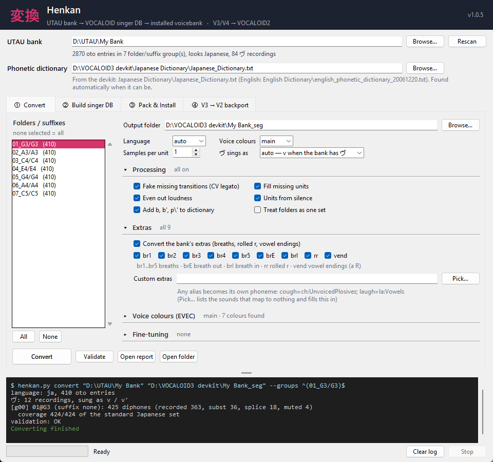

# 変換 Henkan 🎤➡️🎹

[](https://github.com/GooberNiko/Henkan/releases/latest)
[](LICENSE)


**Your UTAU voicebank, but it's a VOCALOID now. Your V3/V4 banks, but they sing in VOCALOID2.**

*Henkan* (変換) means conversion — and that's the whole tool: UTAU bank → VOCALOID singer DB → packed
voicebank → installed in your editor, plus a V3→V2 backport that rewrites V3/V4 voicebanks so VOCALOID2
can sing them. (It used to be called **utau2vocaloid**. Same tool, better name.)



You have an UTAU bank. You have the VOCALOID3 developer kit. You thought "surely there's a button for this."
There was not. Now there is. It's this.

Henkan reads an UTAU bank (`oto.ini`, VCV / CVVC / CV, Japanese or English), figures out where
every phoneme starts and ends *by actually listening to the audio* (oto.ini is a suggestion, not the law),
writes everything the VOCALOID3 DBTool wants, and then **drives the DBTool for you** so you don't have to
click "Add Articulations" 790 times with your own human finger.

> ⚠️ **No Yamaha files included.** You need your own VOCALOID3 developer kit (`VocaloidDBTool3.exe` + its
> phonetic dictionaries). We do not have it, we will not send it, please do not ask the README.

**Jump to:** [Quick start](#-quick-start-the-i-just-want-it-to-sing-path) ·
[The window](#%EF%B8%8F-the-window) · [Extras](#%EF%B8%8F-extras-breaths-rolled-r-end-breaths) ·
[ヴ](#-ヴ-gets-a-real-v-v-and-v) · [Voice colours](#-voice-colours-evec) ·
[Pack & Install](#-pack--install-tab-3-your-bank-in-a-real-editor) ·
[V3→V2](#-v3v2-backport-tab-4-your-v3v4-banks-in-vocaloid2) ·
[Command line](#%EF%B8%8F-command-line-for-people-who-think-guis-are-for-cowards) ·
[Troubleshooting](#-troubleshooting)

---

## 🚀 Quick start (the "I just want it to sing" path)

1. Download the [latest release](https://github.com/GooberNiko/Henkan/releases/latest) and unzip it
   **inside your devkit folder** (next to `VocaloidDBTool3.exe`).
2. `pip install -r requirements.txt`
3. Double-click **`Henkan GUI.bat`**.
4. Pick your UTAU bank → **Convert** → **Build DB**. Go make a sandwich. 🥪 (Building takes a few minutes.
   The DBTool runs in the background on a hidden desktop and clicks itself, so you can keep using the PC.
   If it gets stuck back there, the build runs again with the DBTool on screen: then hands off, it is not
   haunted. Untick **Run the DBTool in the background** (or `build --show-dbtool`) to watch it work.)
5. **Pack & Install** → your bank becomes a real voicebank in your VOCALOID editor.

That's it. That's the README. …okay fine, there's more below.

## 🖥️ The window

Four tabs, in the order you use them:

| Tab | What it's for |
|---|---|
| **① Convert** | Pick folders, then convert. The options fold into sections (**Processing**, **Extras**, **Voice colours**, **Fine-tuning**); a closed section still says what it's set to, so nothing hides from you |
| **② Build singer DB** | Drives the DBTool, hidden in the background. When it's done, the Pack tab already points at the new DB |
| **③ Pack & Install** | `.ddb` + `.ddi` + `.vvd`, a CompID, and an install into any VOCALOID editor on the PC |
| **④ V3 → V2 backport** | V3/V4 banks rewritten so VOCALOID2 can sing them |

The log at the bottom shows exactly what the command line would print (drag the bar above it to resize),
warnings in yellow. The status bar shows how long the current step has taken. Ctrl+L clears the log, F5
rescans the bank, and the window remembers its size, tab and settings.

## 🤔 What it actually does

| Problem | What Henkan does about it |
|---|---|
| Your bank is a beautiful mess of folders | Finds every `oto.ini` at any depth, reads `prefix.map`, figures out pitches (`C3`, `A#3`…) and voice colours (`Soft`, `弱`, `囁`…) by itself |
| Your bank is **CV only** and VOCALOID wants transitions | **Fake CVVC**: splices the missing `[V C]`, `[V V]`, `[V ん]` joins from two samples (phase-aligned, so no robot clicks). CV banks can sing legato now. Congrats |
| Some transitions just… don't exist | Relabels close relatives (`[a k']` from `[a k]`), mutes onsets for `[Sil C]`, fades vowels for `[V Sil]` |
| Long notes sounded like a skipping CD | Held-vowel loops follow the vowel to where it *really* ends, and short ones get several takes stitched together (~0.8 s), level-matched and EQ'd to match the notes around them |
| "ke-ko" came out as "ke-ho" | CV entries whose oto starts right on the burst get their silent closure back |
| `h` sounded like the raw sample | VOCALOID doesn't re-pitch unvoiced sounds, so `h` becomes breath-shaped noise at a sensible volume (not a vowel-loud hiss, we learned that one the hard way) |
| ん before b / t / k sounded wrong | Every ん flavour (`N\ m n N N' J m'`) gets held-note loops and the units VOCALOID asks for, plus `[Sil N\]` for phrases that start on ん |
| A unit buzzes like a bee 🐝 | After building, it **reads back the pitch the DBTool analysed** for every unit; if one is an octave off (= buzzy half-pitch undertone), it fixes it and rebuilds. Automatically. While you eat the sandwich |
| One recording just renders badly no matter what | `--avoid "g' i"` rebuilds that unit from other recordings instead |
| Notes jump in volume | Every unit is scaled to the bank's usual vowel level |
| Your bank is a formant synth with no silence anywhere | Fine. `Sil` is only taken where it's actually silent |

The DBTool's file formats were worked out from the DBTool itself — nerd details in [FORMATS.md](FORMATS.md).

## 🌬️ Extras (breaths, rolled r, end breaths)

If your bank has bonus samples, they become phonemes you can type in the editor:

| Type this | What it is | Made from (UTAU alias) |
|---|---|---|
| `br1` … `br5` | a breath, on its own note | `息1`, `breath2`, or `b1`… in an extras folder |
| `brE` | breath **out** at the end of a phrase | `a R息`, `i R息`… (each vowel its own) |
| `brI` | breath **in** | `a R吸`… |
| `rr` | rolled r (yes, really) | `巻`, `rr` |
| *(nothing to type)* | natural vowel endings `[a Sil]` | `a R`, `i R`… |

Joins the bank never recorded are spliced, so a breath can go right before or after any sung note
(`br1` then `sa`, `a` then `brE`, `rr a`). Extras are picked up from their bonus folder even if you only
selected the singing folders. Every `report.txt` lists which extra came from which sample.
Don't want them all? Tick just the ones you want in the GUI's **Extras** section (br1…br5, brE, brI, rr, vend),
or `--extras br1,brE,rr` on the command line (`all`, `none`, `br` for br1..br5; `--no-extras` still works).

**Custom extras: ANY sound in ANY bank can be ported.** Got a `cough`, a laugh, a growl? Point at it:
`--custom-extra cough=ch:UnvoicedPlosives` (repeatable), or the GUI's **Custom extras → Pick…**
button: it lists every unmapped alias with a tick box, a prefilled phoneme name and a phonetic
group dropdown — no typing needed. The popup scrolls (mouse wheel included), has a **search bar**
that filters as you type, remembers your ticks, and romanizes kana when prefilling names (`xか` → `ka`).
You pick the phoneme name **and its dictionary group** (the DBTool's own twelve: Vowels,
Semivowels, Nasals, UnvoicedFricatives, VoicedFricatives, Whisper, VoicedAffricates,
UnvoicedAffricates, Liquids, UnvoicedPlosives, VoicedPlosives, Silence — plain
voiced/unvoiced also works), it is cut like a breath (`Sil ch Sil`), added to
`dictionary.txt` in that group, joined to vowels both ways, and listed in `report.txt`.
**Pick…** in the GUI (or `--list-unknown` on the CLI) shows every bank alias that currently maps to
nothing — those are your custom-extra candidates.

Already handled without custom extras: `* あ` spare takes, `xか`/`Ｘか` extra takes, small-kana
offglides (`てぅ` → `t e u`, `おぁ` → `o a`, `どぉ` → `d o`), sokuon endings (`e てっ` →
`e t e ?` glottal stop), edge-bank `'` tags (`く'` → `k u`), `V R息` breath endings, and
`息1`/`b1`/`巻` breaths — the Kasane Teto OU bank (6,216 entries) maps every alias with zero unknowns.

## 🅥 ヴ gets a real v (`v` and `v'`)

The devkit's Japanese dictionary has no v, so ヴ used to sing as b. Now, when your bank recorded any ヴ
(`ゔぁ`, `a ヴぃ`, CVVC `a v` …), it becomes its own phonemes: **`v`**, and **`v'`** before i (and ゅ),
the same way `k` / `k'` work. Type `v a`, `v' i`, `v M` … in the editor. `v` and `v'` go into
`dictionary.txt` as VoicedFricatives, and the gaps fill like any other consonant: `[a v']` is borrowed from
`[a v]`, `[Sil v']` is cut from `ヴぃ`, and so on (the report shows which). `ん` before v becomes `m`.

The GUI's **ヴ sings as** box (Convert tab), or `--v-mode`:

- `auto` (default) — `v` / `v'` if the bank has any ヴ, otherwise nothing changes
- `v` — always `v` / `v'`
- `b` — the old way: ヴ is `b` / `b'`

## 🎨 Voice colours (EVEC)

Banks with several colours (Standard / Soft / Whisper…):

- `--colors main` (default) — just the main colour.
- `--colors evec` — **all colours in one DB**. The main one sings with normal phonemes, the next with
  `a#1 k#1 …`, then `#2`… Type the suffixed phonemes in the editor to switch colour.
  (The DBTool thinks `#` starts a comment, so we sneak `aX1` past it and rename it to `a#1` inside the
  built DB. It never suspected a thing.)
- `--colors merge` — treat all colours as one. Chaos mode. Not recommended.
- **EVEC support mode** (`--evec-mode vowels`, or the GUI checkbox) — **only vowels carry the
  `#number`** (`k a#1`, `a#1 k`, shared `k`). Consonants stay shared across colours, so joins
  crossfade and you never type `k#1`. The dictionary only gains vowel `#` entries and shared
  consonants get a single stationary.

Want different colours than the automatic ones? The GUI shows every detected colour with its entry
count, its vowels, and the `prefix.map` affixes after you pick a bank. Choose each colour's EVEC
number — the Convert tab shows one dropdown per detected colour (`main`, `#1`…`#9`, `skip`),
so there is nothing to type (`skip` drops one) — and, if you like, which phonemes each covers
(`Soft:a,i,M,e,o`). The converter finds that colour's transitions (vowels and such) from its own
entries; a colour with no vowels warns you but still converts. Command line: `--evec-map` and
`--evec-phonemes` (a `#` number implies `--colors evec`; automatic numbers never reuse yours).

## 📦 Pack & Install (tab 3: your bank in a real editor)

Once the DB is built, the Pack & Install tab turns it into a voicebank package and installs it
into any VOCALOID editor on your PC — point at the install folder, press Install, say Yes to the
Windows permission prompt:

1. **Pack** — packs the built DB (`<Name>.tree` + `<Name>/voice/…`) into `<CompID>/<name>.ddb +
   <name>.ddi` (same algorithm as ddb-tools' `pack_ddb.py`, built in, no dependency) and writes
   `<name>.vvd` (voicebank name + CompID, same cipher as VVD Editor Plus). CompIDs are picked
   from pools of known-valid V4 IDs (or crafted with the right language digit) and checked
   against every bank registered on your machine.
2. **Install** — copies the package to the bank folder (`VoiceDB\<name>` for VOCALOID4, like the
   commercial banks) and registers it
   (`HKLM\SOFTWARE\VOCALOID4\DATABASE\<CompID>` + the `POCALOID4` mirror the FE voice loader
   reads: PATH, NAME, INSTALLED, TIME, KEYS — the same keys every installed bank on a VOCALOID
   PC carries). VOCALOID2/3 editors get their own registry branches; the VOCALOID4FE developer
   editor instead gets a `DB_Dev.ini` voice slot pointing at your loose DB.
   Files + registry need admin rights, so Install/Uninstall run through generated
   `install.bat`/`uninstall.bat` (same shape as VVD Editor's) launched with a UAC prompt — read
   them in the package folder first if you like.

Command line: `pack "<DB folder>/<Name>" [--out …] [--name …] [--compid …]` then
`install <package> --editor "<editor folder>"` (prints the admin `.bat` to run).

### 🪪 CompIDs (your bank's ID card)

A CompID is the voicebank's 16-character ID (capital letters + digits, e.g.
`BKGHF5N5PSTN4KD6`). It goes in the `.vvd` file, names the package folder, and keys the
registry entries, so the editor can tell your bank apart from every other bank. Underneath it
is a 14-char raw string — `[0]` + a 6-char DRP (vendor 2 + language digit + product 3) +
`00` + a 5-char version — scrambled with the same codec VVD Editor Plus uses (see the
"About CompID" section of its help page). The language digit is what matters: 0-Japanese,
1-English, 2-Korean, 3-Spanish, 4-Chinese — the V4 editor checks it, so install under an ID
whose language matches your bank. Rules: one bank = one ID, no two banks on the same PC may
share one, and repackaging the same bank reuses its ID. (The trailing checksum is trivia —
the editor never checks it, so some real bank IDs don't even decode.)

The **CompID Studio** (the Generate button, or `compid` on the CLI) speaks this language:
a language dropdown, **Pick from pool** (known-valid V4 Japanese/Chinese/English IDs — 19/30/25),
**Craft for language** (a fresh ID with the right language digit — the Korean/Spanish move, since
no V4 pools exist for them), **Random** (a fresh opaque ID), paste-and-check with a decoded
view (raw, vendor, language, product, version), and a raw-string encoder. CLI mirrors it:
`compid --lang Korean`, `--craft`, `--random`, `--check <ID>`, `--encode <raw>`, `--decode <ID>`.

## ⏪ V3→V2 backport (tab 4: your V3/V4 banks in VOCALOID2)

VOCALOID2 can't read V3/V4 voicebanks — but the singing data (`.ddb`) is the same format in every
version; only the index (`.ddi`) changed. The backport tab (the vendored `v3v2` engine from the V3V2
side project) rewrites the index the way VOCALOID2's engine reads it and installs the result as a
singer of its own, in the language you pick:

1. Pick an installed V3/V4 library (they list themselves), browse for a voicebank folder, a
   developer-kit `.tree` — or hand over the Pack tab's built DB straight from this tool.
2. **Convert**, pick a language (**Auto** reads it from the voicebank's phonemes), **Install in
   VOCALOID2** (Windows asks for administrator rights once), open VOCALOID2 and sing.

Converted singers live in `Documents\VOCALOID2 Singers\`. Triphone-only transitions are cut out
into proper diphones, gaps V2 lyrics would hit get closest-sound stand-ins (the report lists how
many), and the big `.ddb` is linked, not copied. Growl and triphones don't exist in V2, so those
stay out. Close VOCALOID2 before installing or uninstalling.

## 🇬🇧 English banks

Arpasing and X-SAMPA-style banks (e.g. Kasane Teto English: `wE`, `e d`, `- skl`, `oU l-`) convert with
English coverage checks and gap filling. Build with `--language English` (the GUI picks it for you when
the bank looks English).

## 🧰 Requirements

- Windows (the DBTool is a Windows program; `convert` alone runs anywhere)
- Python 3.10+
- `pip install -r requirements.txt` (numpy; pywinauto + pywin32 for building)
- The VOCALOID3 developer kit: `VocaloidDBTool3.exe` + its `Japanese Dictionary` / `English Dictionary`
  folders. Put this folder inside the devkit folder, or pass `--dict` and `--dbtool`.
- Optional: VOCALOID4 Editor for Developer, for the test-render tools in `tools/`.

## ⌨️ Command line (for people who think GUIs are for cowards)

(`henkan.py` was called `utau2vocaloid.py` before the rename. The old name still works, so old scripts
and shortcuts keep running.)

```bat
:: 1. convert an UTAU bank
python henkan.py convert "C:\path\to\UTAU bank" "C:\out\MyBank_seg"

:: 2. build the singer DB with the DBTool (a few minutes, hidden; --show-dbtool to watch it)
python henkan.py build "C:\out\MyBank_seg" "C:\out\MyBank\MyBank" --name "MyBank"

:: 3. paranoia
python henkan.py validate "C:\out\MyBank_seg"

:: 4. pack it into a voicebank package (.ddb + .ddi + .vvd)
python henkan.py pack "C:\out\MyBank\MyBank" --name "MyBank"

:: 5. stage the install, then run the printed install.bat as administrator
python henkan.py install "C:\out\package\<CompID>" --editor "C:\Program Files (x86)\VOCALOID4FE"
```

`convert` writes:

- `report.txt` — coverage of the standard diphone set, what was recorded / relabelled / spliced, extras, and
  every oto entry that got skipped *and why* (read this when something sounds weird, it's usually in there)
- `manifest.csv` — where every single unit came from
- `dictionary.txt` — the phonetic dictionary to create the singer DB from

Useful `convert` options:

| option | |
|---|---|
| `--groups REGEX` | only use these folders/suffixes, e.g. `--groups "^Standard"` |
| `--merge-groups` | treat every folder as one sample set |
| `--keep N` | samples kept per unit and pitch (default 1) |
| `--lang ja\|en` | force the language (default: it guesses, and it's usually right) |
| `--dict FILE` | phonetic dictionary `.txt` (default: the devkit's one for the language) |
| `--colors main\|evec\|merge` | voice colours, see above |
| `--avoid "C V"` | don't use this unit's recording; rebuild it from others (for the one unit that's cursed) |
| `--brighten PH=DB` | lift the treble of a dull vowel, e.g. `--brighten o=3` |
| `--extras LIST` | which extras to convert: br1..br5, brE, brI, rr, vend (`all`, `none`, `br`) |
| `--no-extras` | same as `--extras none` |
| `--evec-map "C=#N,..."` | choose EVEC colours/numbers: `Soft=#1,Whisper=#2,Power=main,Old=skip` |
| `--evec-phonemes "C:ph,..."` | choose phonemes per colour: `Soft:a,i,M,e,o;Whisper:a,e` (warns, not stops, without vowels) |
| `--evec-mode full\|vowels` | `vowels` = EVEC support mode: only vowels get `#numbers` |
| `--custom-extra "ALIAS=PH:TYPE"` | custom extra, repeatable: `cough=ch:UnvoicedPlosives`, `laugh=la:Vowels` |
| `--list-unknown` | list aliases mapping to nothing (custom-extra candidates) and exit |
| `--v-mode auto\|v\|b` | ヴ as its own `v` / `v'` (`auto`: when the bank recorded it) or as `b` / `b'` |
| `--no-splice` | don't fake missing transitions |
| `--no-fill` | don't relabel / mute / fade to fill missing units |
| `--no-normalize` | keep each recording's own loudness |
| `--no-extend-dict` | don't add `b`, `b'`, `p\'` (the devkit's Japanese dictionary forgot them) |

Building by hand instead: DBTool → *File → New singer database* from `dictionary.txt`, then
*File → Automatic Segmentation*, point it at the converted folder, run the steps, wait, contemplate life.

## 🧪 Testing in the VOCALOID4 Editor for Developer (`tools/`, command line only)

The dev editor only sings the voices listed in its installed `DB_Dev.ini` (which needs admin to edit, lol).
So `slot.py` borrows one of your existing voice slots with a folder link and **keeps your real DB safe**
next to it as `<folder>__orig`.

| tool | what it does |
|---|---|
| `tools/cycle.py <bank> <tag> [options]` | convert → build → mount → render → check, in one go |
| `tools/render.py <voice no> <out.wav>` | writes a test song (all syllables, legato, long notes, every ん; `--song en` / `--song extras` for English and breaths) and renders it in the dev editor, plus the `.msd` analysis |
| `tools/render_qa.py <song.wav>` | finds doubled plosive bursts, level/timbre jumps where units meet, clicks |
| `tools/msd.py <song.msd>` | prints which unit VOCALOID used when (held notes show up as `[o o]`) |
| `tools/qa.py <converted folder>` | checks a converted folder before building: loop length/seams, dips, cut points, loudness |
| `tools/slot.py mount <voice no> <DB folder>` | points a voice slot at a test DB |
| `tools/slot.py restore <voice no>` | **gives you your voice back** ← remember this one |

## 🩹 Troubleshooting

- **"could not find the phonetic dictionary" / "no dictionary.txt" / "validated it but it says the
  dictionary is missing".** The converter needs the devkit's dictionary: `Japanese Dictionary\Japanese_Dictionary.txt`
  (English banks: `English Dictionary\english_phonetic_dictionary_20061220.txt`). Put the Henkan
  folder inside the devkit folder and it's found automatically, or pick it under **Phonetic dictionary** in
  the GUI (`--dict` on the command line). Then **Convert again** before building.
- **The build got stuck.** In the background it can't wait for you, so it closes that DBTool and runs the
  build again on screen. If it gets stuck there too, it **leaves the DBTool open** and prints what to click:
  select every row → *Add Stationaries To Database* → *Optimize EpR Guides* → *Add Articulations To
  Database* → *Exit*. (Don't close the DBTool while the log says it's working.)
- **"VOCALOID4 is already running."** Yes. Yes it is. Close it, then render.
- **The DBTool window is clicking by itself.** That's us: the background build got stuck and is running
  again where you can see it. Hands off the keyboard for a minute.
- **A syllable sounds weird.** Look it up in `report.txt` (skipped entries + reasons). If one unit is just
  bad, `--avoid "C V"` it.
- **Something buzzes.** The build log says if the DBTool read any unit an octave off. It retries with a fix;
  if it still lists units afterwards, `--avoid` those.
- **I mounted a test DB and now my real voice is gone!!** It's not gone. `python -I tools/slot.py restore <n>`.
- **Long notes still sound loopy.** Your bank's vowels may just be very short. Record longer vowels. We
  believe in you.

## 🚧 Known limits

- Spliced / relabelled units are approximations. Real recordings always win when they exist.
- Phrase-start vowels are built from the steady vowel (the recorded ones faded in slowly in VOCALOID).
- `[d' M]`, `[t' M]` (dyu, tyu) and `[w o]` only exist if your bank recorded them.
- Some units can stay octave-confused in the DBTool even after the automatic fix (the build log names them).

## 🙏 Please

Only convert and share banks whose terms allow it, **credit the original voice provider**, and don't
redistribute Yamaha's developer kit or anything made from VOCALOID's own voice data. Be cool. 😎

## License

MIT, see [LICENSE](LICENSE). VOCALOID is a trademark of Yamaha Corporation; this project is not affiliated
with or endorsed by Yamaha. UTAU is by Ameya/Ayame. Teto is a chimera. Nobody here is affiliated with anybody.
